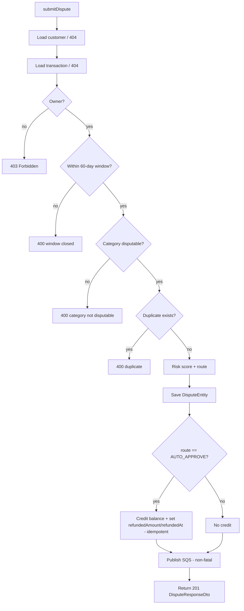

# Design Document

## Overview

This feature layers three server-side regulatory/business rules onto the existing `DisputeService.submitDispute` flow of the South African Transaction Dispute Portal, plus the supporting data model, DTO, and migration changes. It is a backend-only change.

The three rules are:

1. **60-Calendar-Day Dispute Window** (Req 1, 2) — reject disputes submitted more than 60 calendar days after the transaction date, evaluated in the `Africa/Johannesburg` timezone against an injectable `java.time.Clock` so the day-60/day-61 boundary is deterministically testable.
2. **Transaction-Category Eligibility** (Req 3, 4, 5) — every transaction carries a persisted `TransactionCategory`; only disputable categories may be disputed, enforced server-side, and the derived `disputable` flag is exposed on `TransactionResponseDto` for client display.
3. **Immediate Atomic Balance Refund** (Req 6, 7, 8) — auto-approved, rule-cleared disputes immediately credit the account balance with the full transaction amount, inside the same database transaction, idempotently, with an audit trail (`refundedAmount`, `refundedAt`).

All existing dispute behaviors (customer/transaction not-found, ownership, duplicate guard, risk scoring, routing, SQS publish, 201 response) are preserved (Req 10). Every message, the window length, the SAST zone id, and the category disputable classification are centralized in `AppConstants` and the `TransactionCategory` enum — no inline literals in service logic (Req 11). The 80% JaCoCo line-coverage gate on `mvn clean verify` must continue to pass (Req 11.1).

### Design principles applied from the existing code

- Errors flow through `GlobalExceptionHandler` → `ErrorResponseDto`; `BadRequestException` already maps to HTTP 400. The new rejections (window closed, category not disputable) are 400s per Req 9, so they reuse `BadRequestException` — no new handler branch is required.
- Enums are persisted with `@Enumerated(EnumType.STRING)` (consistent with `mandateType`, `status`, `reason`).
- Mapping is done with MapStruct `@Mapper(componentModel = "spring")`.
- `ddl-auto: validate` in every profile means the Hibernate model and the Flyway-created schema must match exactly across prod (PostgreSQL), test (H2), and local (PostgreSQL + seed). Any new column therefore needs: entity field, prod migration, H2 migration, and a value in the local seed insert.

## Architecture

The new logic slots entirely into the existing `@Transactional submitDispute(Long customerId, DisputeRequestDto request)` method. No new transactional boundary is introduced; the refund credit shares the single transaction that persists the dispute, which gives us atomicity and rollback for free (Req 6.3, 6.4).

### Ordered guard sequence

The current method runs: not-found (customer) → not-found (transaction) → ownership → duplicate → score/route → save → SQS. The two new validation guards are inserted **after ownership and before the duplicate guard**:

```
1. Load customer            -> 404 ResourceNotFoundException   (Req 10.3)
2. Load transaction         -> 404 ResourceNotFoundException   (Req 10.3)
3. Ownership check          -> 403 ForbiddenException          (Req 10.1)
4. Dispute-window check     -> 400 BadRequestException (window closed)   (Req 1, 2, 9.1/9.4/9.6)
5. Category eligibility     -> 400 BadRequestException (not disputable)  (Req 4, 9.2/9.5/9.6)
6. Duplicate guard          -> 400 BadRequestException (already exists)  (Req 10.2)
7. Risk score + route       (RiskScoreEngine, DecisionMatrix)  (Req 10 preserved)
8. Build + save DisputeEntity                                   (Req 10 preserved)
9. If AUTO_APPROVE -> atomic refund (credit balance, set audit) (Req 6, 7, 8)
10. Publish to SQS (non-fatal)                                  (Req 10.5)
11. Build DisputeResponseDto                                    (Req 10.4)
```

**Why this order:**

- **Identity/authorization first (1–3).** You must know the actor and that they own the resource before telling them anything else about it. Ownership stays ahead of the business rules so a non-owner gets 403 rather than leaking window/category state about someone else's transaction (preserves Req 10.1 semantics).
- **Window before category (4 before 5).** Both are new 400 rejections; the window is the time-based regulatory gate (PASA) and is the broadest filter, so it is evaluated first. The order between the two does not change which single error surfaces (the first failing guard throws), but a stable, documented order makes behavior predictable and testable.
- **Window and category before duplicate (4,5 before 6).** Req 9.6 requires that a window- or category-rejected submission creates **no** dispute record. Placing these before the duplicate guard means an ineligible transaction is rejected on its merits regardless of whether a prior dispute exists, and we never reach the `existsBy...` query for an ineligible transaction. The duplicate guard remains the last validation before processing so a genuine, eligible, already-disputed transaction still returns the duplicate 400 (Req 10.2).
- **Refund inside the same transaction (9).** Because `submitDispute` is already `@Transactional`, saving the dispute and crediting the account happen in one unit of work. A `RuntimeException` from the account save (or anywhere after) rolls back both, so no partial refund is ever persisted (Req 6.3, 6.4).

### Timezone / clock flow

```
Clock (bean, SAST zone)                 TransactionEntity.transactionDate (OffsetDateTime)
        |                                              |
        v                                              v
LocalDate.now(clock)  ----- ChronoUnit.DAYS ----->  transactionDate.atZoneSameInstant(SAST).toLocalDate()
        |
        v
elapsedDays <= DISPUTE_WINDOW_DAYS (60) ? within window : rejected
```



## Components and Interfaces

### New / changed enums

**`TransactionCategory` (new)** — `com.transaction.dispute.model.enums.TransactionCategory`

Carries the disputable classification on the enum constant itself, so the eligibility rule has a single source of truth and service logic never lists categories inline (Req 3.5, 11.2).

```java
public enum TransactionCategory {
    ONLINE_RETAIL(true),
    MOBILE_CONTRACT(true),
    GYM_MEMBERSHIP(true),
    LOAN(true),
    MUNICIPAL(true),
    P2P_TRANSFER(false),
    IN_STORE_RETAIL(false);

    private final boolean disputable;

    TransactionCategory(boolean disputable) {
        this.disputable = disputable;
    }

    public boolean isDisputable() {
        return disputable;
    }
}
```

**`MandateType` (changed)** — add `REGISTERED_MANDATE` (Req 3.8). `RiskScoreEngine` already treats any non-`DEBICHECK` mandate as the +50 branch, so `REGISTERED_MANDATE` scores like `STANDARD_EFT` with no engine change required.

```java
public enum MandateType {
    STANDARD_EFT,
    DEBICHECK,
    REGISTERED_MANDATE
}
```

### Changed entities

**`TransactionEntity` (changed)** — add the persisted category column (Req 3.1):

```java
@Enumerated(EnumType.STRING)
@Column(name = "category", nullable = false, length = 50)
private TransactionCategory category;
```

**`DisputeEntity` (changed)** — add refund audit fields (Req 8.3). Both nullable; unset while not refunded (Req 8.5):

```java
@Column(name = "refunded_amount", precision = 19, scale = 2)
private BigDecimal refundedAmount;

@Column(name = "refunded_at")
private OffsetDateTime refundedAt;
```

### New configuration

**`TimeConfig` (new)** — `com.transaction.dispute.config.TimeConfig`. Provides the `Clock` bean so the service never calls the system clock directly (Req 2.1). Default production bean is anchored to the SAST zone so `LocalDate.now(clock)` yields the correct South African calendar day:

```java
@Configuration
public class TimeConfig {

    @Bean
    public Clock clock() {
        return Clock.system(ZoneId.of(AppConstants.DISPUTE_TIMEZONE)); // "Africa/Johannesburg"
    }
}
```

Tests override this bean with `Clock.fixed(instant, SAST)` to assert the boundary deterministically (Req 2.2). `spring.main.allow-bean-definition-overriding: true` is already set in `application-test.yml`, so a `@TestConfiguration` fixed-clock bean cleanly replaces the production one.

### Changed service

**`DisputeService` (changed)** — inject `Clock` and `AccountRepository`; add two private guards and the refund step. Signatures:

```java
private final Clock clock;                 // new dependency
private final AccountRepository accountRepository; // new dependency

@Transactional
public DisputeResponseDto submitDispute(Long customerId, DisputeRequestDto request);

// New private helpers (within DisputeService):
private void assertWithinDisputeWindow(TransactionEntity transaction);
private void assertCategoryDisputable(TransactionEntity transaction);
private void applyRefundIfEligible(DisputeEntity dispute, DecisionRoute route);
```

Guard bodies (behavioral spec):

- `assertWithinDisputeWindow`: compute `txDate = transaction.getTransactionDate().atZoneSameInstant(ZoneId.of(AppConstants.DISPUTE_TIMEZONE)).toLocalDate()` and `today = LocalDate.now(clock)`; `elapsed = ChronoUnit.DAYS.between(txDate, today)`. If `elapsed > AppConstants.DISPUTE_WINDOW_DAYS` throw `new BadRequestException(AppConstants.MSG_DISPUTE_WINDOW_CLOSED)` (Req 1.2, 1.4). `elapsed == 60` passes (Req 1.3); `elapsed == 61` fails (Req 1.4). Applies to all mandate types including `REGISTERED_MANDATE` because the check never inspects mandate type (Req 1.7).
- `assertCategoryDisputable`: if `!transaction.getCategory().isDisputable()` throw `new BadRequestException(AppConstants.MSG_CATEGORY_NOT_DISPUTABLE)` (Req 4.2). Runs for every submission regardless of origin because it lives in the service, not the controller (Req 4.3).
- `applyRefundIfEligible`: if `route == DecisionRoute.AUTO_APPROVE` and `dispute.getRefundedAmount() == null` (idempotency guard, Req 7.1/7.3), then `account.setBalance(account.getBalance().add(transaction.getAmount()))`, `accountRepository.save(account)`, `dispute.setRefundedAmount(transaction.getAmount())`, `dispute.setRefundedAt(OffsetDateTime.now(clock))` (Req 6.1, 8.1, 8.2). For `MANUAL_INVESTIGATION` it does nothing — no credit, audit fields stay null (Req 6.2, 8.5). Because category/window are already enforced upstream, reaching this method with `AUTO_APPROVE` means the dispute is window-valid and category-disputable (Req 6.1 compound condition).

Reaching the refund within the single `@Transactional` method means the dispute `save` and the account `save` commit or roll back together (Req 6.3, 6.4).

### Changed mapper

**`TransactionMapper` (changed)** — map the derived flag onto the DTO (Req 5.1–5.3). MapStruct expression mapping keeps the derivation declarative and co-located with the mapping:

```java
@Mapper(componentModel = "spring", unmappedTargetPolicy = ReportingPolicy.IGNORE,
        imports = {}) // category is on the entity
public interface TransactionMapper {

    @Mapping(target = "disputable", expression = "java(entity.getCategory().isDisputable())")
    TransactionResponseDto toDto(TransactionEntity entity);

    List<TransactionResponseDto> toDtoList(List<TransactionEntity> entities);
}
```

The expression calls `TransactionCategory.isDisputable()`, so the flag is always consistent with the single source of truth (Req 5.2, 5.3).

### Changed DTOs

**`TransactionResponseDto` (changed)** — add `boolean disputable` (Req 5.1):

```java
public record TransactionResponseDto(
        Long transactionId,
        String reference,
        String merchant,
        BigDecimal amount,
        String currency,
        MandateType mandateType,
        TransactionStatus status,
        OffsetDateTime transactionDate,
        boolean disputable            // new
) {}
```

**`DisputeResponseDto` (changed)** — surface the refunded amount so a client/auditor can see the immediate credit on the submission response. Recommended: add a nullable `BigDecimal refundedAmount` field, null for manual-investigation disputes.

```java
// add field:
BigDecimal refundedAmount
```

`DisputeMapper` already maps most fields; add `@Mapping(source = "refundedAmount", target = "refundedAmount")` (field names match, so MapStruct maps it by default — explicit mapping is optional). The `submitDispute` and `getDisputeHistory` manual re-construction of the record must pass `saved.getRefundedAmount()` / `entity.getRefundedAmount()` through. This is additive and does not disturb existing fields (Req 10 preserved).

### AppConstants additions (Req 9.3, 11.2)

```java
// Dispute window
public static final int DISPUTE_WINDOW_DAYS = 60;
public static final String DISPUTE_TIMEZONE = "Africa/Johannesburg";

// Rejection messages
public static final String MSG_DISPUTE_WINDOW_CLOSED =
        "This transaction can no longer be disputed. The 60-day dispute window has closed.";
public static final String MSG_CATEGORY_NOT_DISPUTABLE =
        "This transaction category is not eligible for dispute.";
```

## Data Models

### Entity field summary

| Entity | New field | Column | Type | Nullable |
|---|---|---|---|---|
| `TransactionEntity` | `category` | `category` | `VARCHAR(50)` (enum string) | NOT NULL |
| `DisputeEntity` | `refundedAmount` | `refunded_amount` | `DECIMAL(19,2)` | nullable |
| `DisputeEntity` | `refundedAt` | `refunded_at` | `TIMESTAMPTZ` / `TIMESTAMP WITH TIME ZONE` | nullable |

### Enums

- `TransactionCategory` — ONLINE_RETAIL, MOBILE_CONTRACT, GYM_MEMBERSHIP, LOAN, MUNICIPAL (disputable); P2P_TRANSFER, IN_STORE_RETAIL (non-disputable). (Req 3.2–3.4)
- `MandateType` — add REGISTERED_MANDATE. (Req 3.8)

### Migrations

Prod migrations live in `src/main/resources/db/migration`; H2 test migrations in `src/test/resources/db/migration-h2`. Both get new versioned files with the same intent so `ddl-auto: validate` passes in every profile (Req 3.6, 3.7, 8.4). Because `category` is NOT NULL and existing rows (seed/local, and any prod rows) must satisfy validation, the migration adds the column with a **default + backfill** then is safe to keep the default or drop it; we keep a column DEFAULT so inserts that omit the category (none in app code, but the seed is explicit) still succeed.

**Prod `V2__add_transaction_category.sql`** (`db/migration`):

```sql
-- Req 3.1, 3.6
ALTER TABLE transactions
    ADD COLUMN category VARCHAR(50) NOT NULL DEFAULT 'ONLINE_RETAIL';

-- Backfill is covered by the DEFAULT for existing rows.
-- Keep the default so the column is self-consistent under ddl-auto=validate.
```

**Prod `V3__add_dispute_refund_audit.sql`** (`db/migration`):

```sql
-- Req 8.3, 8.4
ALTER TABLE disputes ADD COLUMN refunded_amount DECIMAL(19,2);
ALTER TABLE disputes ADD COLUMN refunded_at     TIMESTAMPTZ;
```

**H2 `V2__add_transaction_category.sql`** (`db/migration-h2`):

```sql
-- Req 3.7
ALTER TABLE transactions
    ADD COLUMN category VARCHAR(50) NOT NULL DEFAULT 'ONLINE_RETAIL';
```

**H2 `V3__add_dispute_refund_audit.sql`** (`db/migration-h2`):

```sql
-- Req 8.4
ALTER TABLE disputes ADD COLUMN refunded_amount DECIMAL(19,2);
ALTER TABLE disputes ADD COLUMN refunded_at     TIMESTAMP WITH TIME ZONE;
```

Note on versioning: the H2 path currently only has `V1`, so `V2`/`V3` there are new. The prod path has `V1` (and the local-only seed `V2__seed_local_data.sql` lives in `db/seed`, a separate location loaded only by the local profile — it does not share the `db/migration` version namespace). To avoid a confusing version clash in the operator's mental model, the prod category migration is `V2` in `db/migration` and the seed stays `V2` in `db/seed`; Flyway tracks them independently per configured location set. If the project prefers unambiguous numbering, bump the prod files to `V3`/`V4` — the design's requirement is only that the two schema columns are added via Flyway on both the prod and H2 paths.

**Local seed update** (`db/seed/V2__seed_local_data.sql`): every seeded `INSERT INTO transactions (...)` must include a `category` value so the seeded rows carry explicit, meaningful categories (and so local startup validates cleanly against the new NOT NULL column rather than relying on the DEFAULT). Map the existing seed rows by merchant intent, for example: gym merchants → `GYM_MEMBERSHIP`, loans → `LOAN`, Pick n Pay retail → `IN_STORE_RETAIL` (non-disputable, useful to demo a rejection) or `ONLINE_RETAIL`. The `INSERT` column list and `VALUES` tuples add `category` accordingly. No new seed migration version is needed; edit the existing `V2__seed_local_data.sql` since it has not shipped to an immutable environment (local/docker rebuild).


## Correctness Properties

*A property is a characteristic or behavior that should hold true across all valid executions of a system — essentially, a formal statement about what the system should do. Properties serve as the bridge between human-readable specifications and machine-verifiable correctness guarantees.*

The feature's core logic — calendar-day window evaluation, category classification, balance arithmetic, and idempotent refunding — is pure, input-driven logic with large input spaces (dates, amounts, categories, mandate types), which makes property-based testing appropriate. Schema/migration, HTTP status mapping, and no-hardcoding requirements are covered by integration, example, and smoke tests in the Testing Strategy rather than as properties.

### Property 1: Dispute-window boundary and determinism

*For all* transaction dates and fixed reference-clock instants, the dispute-window check accepts the dispute if and only if the elapsed calendar days (transaction date to the clock date, both as `Africa/Johannesburg` `LocalDate`) is less than or equal to `DISPUTE_WINDOW_DAYS` (60), and evaluating the same date and the same fixed clock yields the same decision every time.

**Validates: Requirements 1.1, 1.2, 2.3**

### Property 2: Window decision is independent of mandate type

*For all* mandate types (STANDARD_EFT, DEBICHECK, REGISTERED_MANDATE), given the same transaction date and the same reference-clock instant, the dispute-window decision is identical.

**Validates: Requirements 1.7**

### Property 3: Category disputable classification

*For all* `TransactionCategory` values, `isDisputable()` returns true exactly for ONLINE_RETAIL, MOBILE_CONTRACT, GYM_MEMBERSHIP, LOAN, and MUNICIPAL, and false exactly for P2P_TRANSFER and IN_STORE_RETAIL.

**Validates: Requirements 3.3, 3.4**

### Property 4: Category eligibility gate

*For all* dispute submissions whose other guards pass, the submission proceeds past the category guard if and only if the transaction's category is disputable; a non-disputable category is rejected with the category-not-disputable error.

**Validates: Requirements 4.1, 4.2**

### Property 5: Blocked submissions create no dispute record

*For all* submissions rejected because the dispute window has closed or the category is non-disputable, no `DisputeEntity` is persisted.

**Validates: Requirements 9.6**

### Property 6: Response disputable flag mirrors category

*For all* transactions, the `disputable` field of the mapped `TransactionResponseDto` equals the transaction category's `isDisputable()` value.

**Validates: Requirements 5.1, 5.2, 5.3**

### Property 7: Auto-approved refund credits balance and records audit

*For all* eligible auto-approved disputes (within window, disputable category, route AUTO_APPROVE), the account balance after processing equals the balance before plus the full transaction amount, the dispute's `refundedAmount` equals that amount, and the dispute's `refundedAt` is set.

**Validates: Requirements 6.1, 8.1, 8.2**

### Property 8: Manual-investigation disputes are not refunded

*For all* disputes routed to MANUAL_INVESTIGATION, the account balance is unchanged and the dispute's `refundedAmount` and `refundedAt` remain unset.

**Validates: Requirements 6.2, 8.5**

### Property 9: Refund idempotence

*For all* already-refunded disputes, applying the refund step again leaves the account balance equal to the balance after a single credit and leaves `refundedAmount` unchanged.

**Validates: Requirements 7.1, 7.2, 7.3**

## Error Handling

- **Window closed** and **category not disputable** are both client errors that must return HTTP 400 with an `ErrorResponseDto` (Req 9.1, 9.2). Both are raised as `BadRequestException`, which `GlobalExceptionHandler.handleBadRequest` already maps to 400 with the exception message in the body. **No new handler branch is added** — reusing `BadRequestException` keeps the error contract and body shape identical to the existing duplicate-dispute 400, satisfying Req 9 without touching `GlobalExceptionHandler`.
- The two rejections carry **distinct, centralized messages** (`MSG_DISPUTE_WINDOW_CLOSED`, `MSG_CATEGORY_NOT_DISPUTABLE`) so a consumer can distinguish them (Req 9.3, 9.4, 9.5).
- Because both guards run before any `DisputeEntity` is built or saved, a rejected submission leaves no dispute record (Req 9.6).
- **Refund failure / rollback:** the account credit and the dispute save share the method's single `@Transactional` unit. Any `RuntimeException` (e.g., from `accountRepository.save`) propagates and triggers a full rollback — neither the dispute nor the balance change is committed, so no partial refund can exist (Req 6.3, 6.4). `BadRequestException`, `ForbiddenException`, and `ResourceNotFoundException` are unchecked and likewise roll back the transaction, which is the desired behavior for the pre-save guards.
- Existing behaviors are untouched: ownership → 403 (`ForbiddenException`), duplicate → 400 (`BadRequestException`), not-found → 404 (`ResourceNotFoundException`), SQS publish failure → non-fatal (Req 10.1–10.5).

## Testing Strategy

### Dual approach

- **Property-based tests** verify Properties 1–9 across generated inputs (dates, clocks, amounts, balances, categories, mandate types), minimum **100 iterations** each.
- **Unit / example / integration tests** cover boundaries, HTTP mapping, schema/migration, atomicity, and preserved behaviors.

### Property-based testing library

Use **jqwik** (JUnit 5 property-based testing for Java) — add it as a `test` scope dependency in `pom.xml`. Do not hand-roll property testing. Configure each `@Property` with `@Property(tries = 100)` (or higher). Tag each property test with a comment:

```
// Feature: regulatory-dispute-eligibility, Property N: <property text>
```

Each of Properties 1–9 is implemented by exactly one property-based test:

- **P1 window boundary + determinism** — generate a base `transactionDate` and an `elapsedDays` across a wide range (e.g., 0–200), build `Clock.fixed(transactionDate + elapsedDays, SAST)`, and assert the window check accepts iff `elapsedDays <= 60`; evaluate twice and assert equal results. Runs against the pure guard logic (no DB needed) and, for an end-to-end slice, against `DisputeService` with H2 and an overriding fixed-clock `@TestConfiguration`.
- **P2 mandate independence** — for a generated date/clock, iterate all `MandateType` values and assert the window decision is identical.
- **P3 category classification** — iterate all `TransactionCategory` values and assert `isDisputable()` matches the specification table.
- **P4 category eligibility gate** — generate a category; with all other guards satisfied, assert the submission proceeds iff `category.isDisputable()`, else throws `BadRequestException(MSG_CATEGORY_NOT_DISPUTABLE)`.
- **P5 no record on block** — generate either an out-of-window date or a non-disputable category and assert `disputeRepository.save` is never called (Mockito `verify(..., never())`) / repository count unchanged (H2).
- **P6 mapper flag** — generate a `TransactionEntity` with a random category and assert `TransactionMapper.toDto(e).disputable() == e.getCategory().isDisputable()`.
- **P7 refund credit + audit** — generate `startingBalance` and `amount` (`BigDecimal`), process an eligible AUTO_APPROVE dispute, assert `newBalance.compareTo(startingBalance.add(amount)) == 0`, `refundedAmount.compareTo(amount) == 0`, and `refundedAt != null`.
- **P8 no refund on manual** — force MANUAL_INVESTIGATION (reason/mandate producing score > 50) and assert balance unchanged and audit fields null.
- **P9 idempotence** — apply the refund step twice to the same dispute and assert the balance equals a single credit and `refundedAmount` is unchanged.

### Deterministic 60-day boundary against H2

Boundary examples use a fixed clock supplied via a test configuration that overrides the production `Clock` bean (`spring.main.allow-bean-definition-overriding: true` is already set in `application-test.yml`):

```java
@TestConfiguration
static class FixedClockConfig {
    @Bean Clock clock() {
        return Clock.fixed(Instant.parse("2026-06-01T10:00:00Z"),
                           ZoneId.of("Africa/Johannesburg"));
    }
}
```

- **Day 60 (Req 1.3):** seed a transaction with `transactionDate` exactly 60 SAST-days before the fixed clock date; assert the dispute is accepted (proceeds to routing/201).
- **Day 61 (Req 1.4):** seed exactly 61 SAST-days before; assert `BadRequestException(MSG_DISPUTE_WINDOW_CLOSED)` and no dispute persisted.
- **Zone correctness (Req 1.5):** use a `transactionDate` instant that lands on a different calendar day in UTC vs SAST and assert the SAST day drives the count.
- **Clock injection (Req 2.1, 2.2):** a fixed future clock turns an otherwise-in-window transaction into a rejection, proving the service reads the injected clock rather than the system clock.

### Category eligibility (Req 4)

- Example tests: submit against each disputable category → proceeds; against each non-disputable category → 400 with the category message and no record (Property 4/5 reinforce with full coverage).
- Enforcement is at the service layer, so a controller/`MockMvc` test confirms a direct API call to dispute a non-disputable transaction returns 400 (Req 4.3, 9.2).

### Refund: credit, idempotency, atomicity/rollback (Req 6, 7, 8)

- **Credit (6.1, 8.1, 8.2):** Property 7 plus an H2 integration test that reloads the account and dispute and asserts the persisted balance and audit fields.
- **No credit on manual (6.2, 8.5):** Property 8 plus an example.
- **Idempotency (7.1–7.3):** Property 9 plus an explicit example re-invoking the refund path on an already-refunded dispute.
- **Atomicity / rollback (6.3, 6.4):** example test using a spy/stub `AccountRepository` whose `save` throws a `RuntimeException`; assert the whole `submitDispute` transaction rolls back — no `DisputeEntity` row (count unchanged) and the account balance unchanged after the method throws. Run with `@DataJpaTest`/`@SpringBootTest` + H2 so the real transaction manager participates.

### Mapper disputable flag (Req 5)

- Property 6 (generated categories) plus two examples (one disputable, one non-disputable) asserting `disputable` true/false in the DTO.

### Preservation of existing behavior (Req 10)

- Keep/extend the existing `DisputeServiceTest` cases: not-found 404 (10.3), ownership 403 (10.1), duplicate 400 (10.2), eligible 201 with routing outcome (10.4), SQS failure non-fatal (10.5). These must still pass unchanged aside from the new required inputs (category on seeded transactions, a within-window `transactionDate` under the fixed clock).

### Schema / migration / smoke (Req 3.1/3.6/3.7, 8.3/8.4, 11, 9.3)

- The test suite boots under `ddl-auto: validate` against H2; a green context start proves the H2 migrations match the entity model (new `category`, `refunded_amount`, `refunded_at` columns). A `@SpringBootTest` context-loads test makes this explicit.
- Smoke/unit assertions: `AppConstants.DISPUTE_WINDOW_DAYS == 60`, `DISPUTE_TIMEZONE == "Africa/Johannesburg"`, the two messages are distinct and non-blank (Req 9.3), `TransactionCategory.values()` is the expected 7 (Req 3.2), `MandateType` contains `REGISTERED_MANDATE` (Req 3.8).
- **Coverage gate (Req 11.1):** the new guard branches (within/at/over window, disputable/non-disputable, auto/manual, already-refunded) and the mapper expression are each exercised by the property and example tests above, keeping JaCoCo line coverage ≥ 80% on `mvn clean verify`.

## Requirements Mapping

| Requirement | Satisfied by design element |
|---|---|
| **1** 60-day window | `DisputeService.assertWithinDisputeWindow` using `ChronoUnit.DAYS` in SAST vs `DISPUTE_WINDOW_DAYS`; guard step 4; Property 1; day-60/61 boundary tests. 1.5 SAST conversion via `atZoneSameInstant`; 1.6 `AppConstants.DISPUTE_WINDOW_DAYS`; 1.7 mandate-independent check (Property 2). |
| **2** Deterministic time | `TimeConfig` `Clock` bean injected into `DisputeService`; `LocalDate.now(clock)`; fixed-clock `@TestConfiguration` override; Property 1 determinism. |
| **3** Category model | `TransactionCategory` enum (7 values, disputable flag); `TransactionEntity.category` NOT NULL column; prod + H2 `V2` migrations with DEFAULT backfill; local seed updated; `MandateType.REGISTERED_MANDATE`. Properties 3; smoke tests 3.2/3.8. |
| **4** Eligibility enforcement | `assertCategoryDisputable` guard (step 5) in the service; Properties 4 and 5; controller test for 4.3. |
| **5** Expose flag | `TransactionResponseDto.disputable`; `TransactionMapper` `@Mapping(expression = isDisputable())`; Property 6. |
| **6** Atomic refund | `applyRefundIfEligible` within the single `@Transactional submitDispute`; `accountRepository.save`; Properties 7, 8; rollback example for 6.3/6.4. |
| **7** Idempotency | `refundedAmount == null` guard in `applyRefundIfEligible`; Property 9 + idempotency example. |
| **8** Audit trail | `DisputeEntity.refundedAmount`/`refundedAt`; prod + H2 `V3` migrations; Properties 7 (set) and 8 (unset). |
| **9** Rejection semantics | `BadRequestException` → existing `handleBadRequest` 400; distinct `MSG_DISPUTE_WINDOW_CLOSED` / `MSG_CATEGORY_NOT_DISPUTABLE`; guards precede dispute creation (Property 5); controller 400 tests. |
| **10** Preserved behavior | Guard ordering keeps not-found/ownership/duplicate/routing/SQS intact; existing `DisputeServiceTest` cases retained; refund/response additions are additive. |
| **11** Quality gates | No-hardcoding via `AppConstants` + enum flag; coverage sustained by property + example tests across all new branches; `mvn clean verify` JaCoCo 80% gate. |
